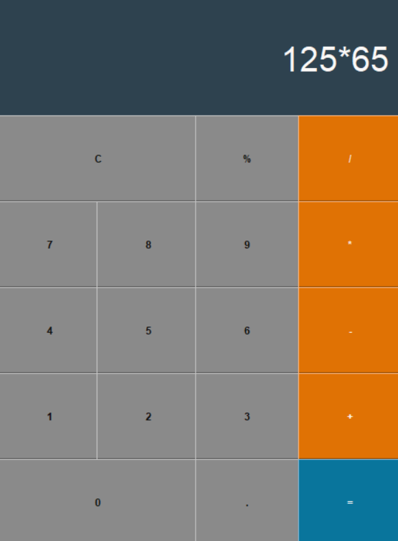

# Calculadora Desktop em Python (Tkinter)

Aplicação desktop de calculadora desenvolvida em **Python** utilizando a biblioteca gráfica nativa **Tkinter**, com suporte a interações via mouse e teclado físico e avaliação segura de expressões matemáticas.

---

## 📌 Visão Geral

O projeto foi estruturado com separação clara de responsabilidades entre interface gráfica, paleta visual e lógica de cálculo:

* **Operações Suportadas:** Adição (`+`), subtração (`-`), multiplicação (`*`), divisão (`/`), módulo (`%`) e números decimais (`.`).
* **Avaliação Segura (`ast`):** Utiliza análise sintática abstrata (`ast`) em vez de `eval()` puro, prevenindo execução arbitrária de código e tratando divisões por zero ou expressões incompletas sem travar a interface.
* **Atalhos de Teclado:** Suporte completo para digitação direta pelo teclado numérico, `Enter` para calcular, `Backspace` para apagar o último caractere e `Esc` para limpar o visor.



---

## 🛠️ Tecnologias Utilizadas

* **[Python 3.14](https://www.python.org/):** Linguagem base da aplicação.
* **[Tkinter](https://docs.python.org/3/library/tkinter.html):** Biblioteca padrão do Python para construção da interface gráfica (GUI).
* **[AST (Abstract Syntax Trees)](https://docs.python.org/3/library/ast.html):** Módulo nativo utilizado para interpretar e calcular expressões aritméticas com segurança.

---

## 📂 Estrutura do Repositório

```text
calculadora/
├── assets/
│   └── preview.png        # Captura de tela da interface da calculadora
├── src/
│   ├── __init__.py
│   ├── theme.py           # Paleta de cores, dimensões e tipografia
│   ├── logic.py           # Motor de avaliação matemática e tratamento de erros
│   └── ui.py              # Construção da janela Tkinter e eventos de teclado
├── main.py                # Ponto de entrada da aplicação
├── .gitignore
└── README.md              # Documentação do projeto
```

---

## 🚀 Como Executar

### 1. Clonar o repositório
```bash
git clone https://github.com/AntoniooAlbuquerque/calculadora.git
cd calculadora
```

### 2. Executar a aplicação
Como o projeto utiliza exclusivamente módulos nativos da biblioteca padrão do Python, não há necessidade de instalar dependências externas:
```bash
python main.py
```

---

## 👨‍💻 Autor

Desenvolvido por **[Antônio Carlos Pessoa de Albuquerque](https://github.com/AntoniooAlbuquerque)** — Estudante de Engenharia da Computação na **POLI/UPE**.